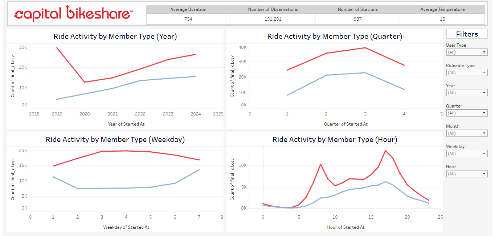
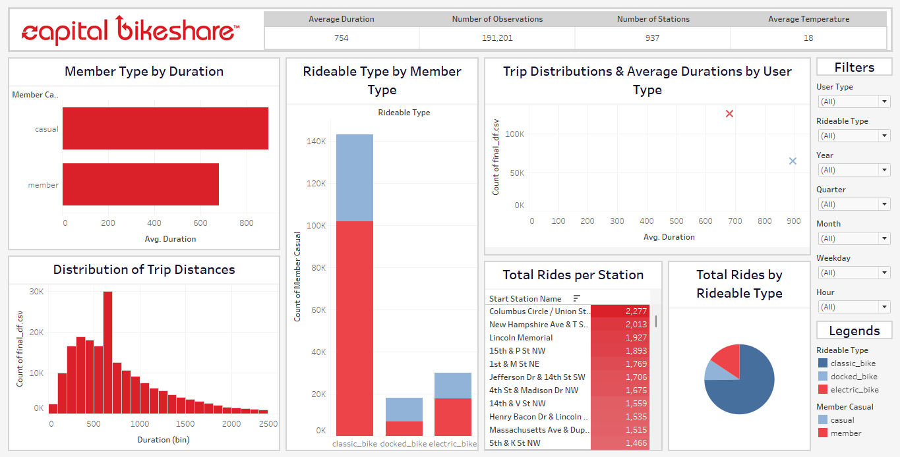
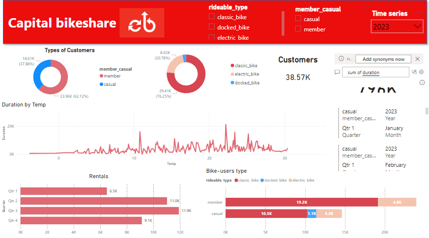
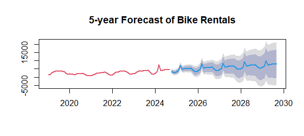

# 🚲 Capital Bikeshare: Business Intelligence Project

**Graduation Project, Middle East University (2025) · Awarded Best Graduation Project**

An end-to-end BI project on the **Capital Bikeshare** system in Washington, D.C. It studies how time, weather, and rider type drive bike rentals from 2019 to 2024, forecasts future demand, and turns the findings into recommendations for launching a similar bike-sharing system in **Jordan**.

## 📌 Overview
| | |
|---|---|
| **Data** | Capital Bikeshare public trip data, Jan 2019 to Oct 2024 (22M+ trips), joined with daily D.C. weather |
| **Sample** | 1% random sample for analysis; ~192K cleaned trips with temperature and precipitation included here |
| **Tools** | R (dplyr, lubridate, ggplot2, forecast), Power BI, Tableau |
| **Methods** | Data cleaning, IQR outlier handling, EDA, correlation and regression, ARIMA forecasting |
| **Team** | Waseem Mahmoud and Dania Saleh, supervised by Dr. Abdelaziz Saleh Mohammad |

## 🔍 What I Did
- **Combined 60+ monthly trip files** in R, standardized column names that changed across years, and fixed data types.
- **Cleaned the data:** removed impossible trips (end before start, invalid coordinates), handled missing values, and removed outliers with the IQR rule.
- **Sampled** 1% of all trips at random, plus a stratified sample (equal trips per month) for fair month-to-month comparisons.
- **Linked each trip to daily weather** (average temperature, precipitation) and imputed missing weather values.
- **Explored demand** by year, quarter, weekday, and hour; compared members with casual riders; and ranked the busiest stations.
- **Measured the weather effect** with correlation and linear regression on quarterly data.
- **Forecast monthly rentals 5 years ahead** with an ARIMA model, tested on a 12-month hold-out period.
- **Built interactive dashboards** in Tableau (2 pages) and Power BI with filters for rider type, bike type, year, quarter, month, weekday, and hour.

## 📊 Key Results
- **Commuting drives demand:** rentals peak at weekday rush hours, so most members use the bikes to get to work or school.
- **Seasonality:** Q2 (spring and early summer) has the highest rentals; cold and rainy months have the lowest.
- **Weather matters:** temperature is positively correlated with both the number of rentals and trip length.
- **Short trips:** the median trip is about **11 minutes**; casual riders take longer, leisure-style trips.
- **Rider mix:** about **66% of trips are by members** and 34% by casual riders; classic bikes make up about 75% of trips.
- **Forecast:** the ARIMA model reached a **MAPE of 10.87%** and projects continued growth in rentals.
- **For Jordan:** start in flat, high-traffic areas near transit hubs and universities, add e-bikes for hilly areas, provide shaded rest stops for the hot climate, and keep pricing affordable.

## 🖼️ Dashboard Preview
**Tableau, page 1: ride activity by year, quarter, weekday, and hour**


**Tableau, page 2: trip duration, bike type, and station usage**


**Power BI dashboard**


**5-year rental forecast (ARIMA)**


## ▶️ How to View
- **Power BI:** open [`dashboards/capital_bikeshare_dashboard.pbix`](dashboards/capital_bikeshare_dashboard.pbix) in [Power BI Desktop](https://powerbi.microsoft.com/desktop/) (free, Windows).
- **Full analysis:** read the project report in [`report/`](report/Bike_Sharing_Jordan_Graduation_Project.pdf).
- **R scripts:**
  1. Unzip `data/bikeshare_trips_sample_clean.zip` into `data/`.
  2. Install the packages: `install.packages(c("dplyr", "readr", "janitor", "lubridate", "ggplot2", "gridExtra", "geosphere", "ggcorrplot", "forecast"))`.
  3. Set the repo folder as your working directory and run the scripts in `R/` in order.
  4. To rebuild the sample from scratch, download the monthly trip files from [Capital Bikeshare System Data](https://capitalbikeshare.com/system-data) into `data/raw/` and run `01_combine_and_clean_trips.R`.

## 📁 Project Structure
```
├── R/
│   ├── 01_combine_and_clean_trips.R   # Combine monthly files, clean, and sample 1%
│   ├── 02_exploratory_analysis.R      # Duration, hourly, weekday, and monthly patterns
│   ├── 03_weather_correlation.R       # Temperature vs. rentals and trip duration
│   └── 04_time_series_forecast.R      # ARIMA 5-year forecast with MAPE
├── data/
│   └── bikeshare_trips_sample_clean.zip  # ~192K cleaned trips with weather (CSV)
├── dashboards/
│   └── capital_bikeshare_dashboard.pbix  # Power BI dashboard
├── report/
│   └── Bike_Sharing_Jordan_Graduation_Project.pdf  # Full graduation project report
└── images/                             # Dashboard and forecast screenshots
```

> Scripts 03 and 04 are adapted from the code published in the report so they run on the included sample.

## 📚 Data Source
Trip data: [Capital Bikeshare System Data](https://capitalbikeshare.com/system-data), made available by Motivate International under the Capital Bikeshare Data License Agreement.

## 👤 Author
**Waseem Mahmoud** · [LinkedIn](https://www.linkedin.com/in/waseem-mahmoud-a34154213) · [GitHub](https://github.com/waseemalali)
